Digital Stethoscope
(Note: Anything in this repo is work I have done directly (with assistance of my instructor, peers, AI, etc.) and there is some analysis done by others on same project but I havent added that in this repo(ps:I dont have that analysis))
I was given good amount of freedom for one of my course project. I wanted to see if I could make a stethoscope that counts its own heartbeats. It turned into a few weeks of ESP32, filters, a lot of MATLAB staring, and arguing with a microphone.

What came out: a stethoscope head with a mic stuck on the end of the tube, an ESP32 that cleans the signal and finds the lub-dub, a red LED that blinks on every beat, a little LCD that shows the rate, and a Bluetooth page that shows the same thing plus a live plot. It runs off a power bank, so no laptop or wall socket is needed.

Not a medical device, just an attempt that still have problems that I plan to tackle in future.

 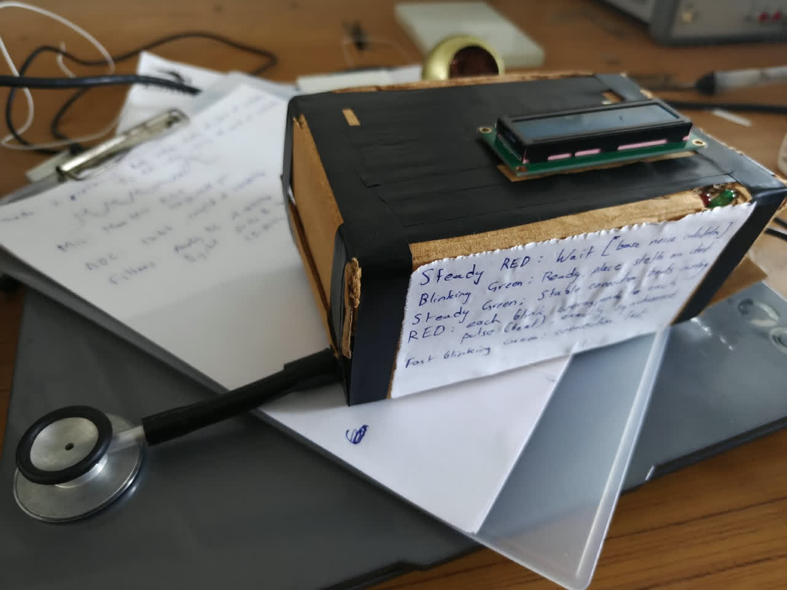 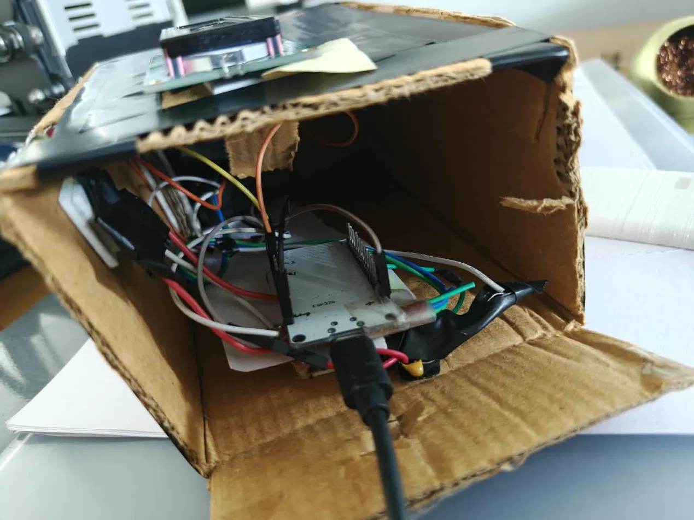 

Watch it work

Click a preview to open the full video.

<table>
  <tr>
    <td align="center"><a href="Steth_sirkesaamnewalatest.mp4">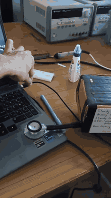</a> The finished box (will hopefully replace the cardboard with 3D printed box in winters)</td>
    <td align="center"><a href="Pulses_neck.mp4">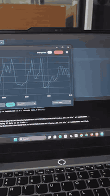</a> The live Arduino Serial Plotter trace</td>
    <td align="center"> My first proper recording, from the neck, where lub and dub finally showed up relatively clearly</td>
  </tr>
</table>

What the LEDs mean
LED	Meaning
Red, steady	Wait. It's learning the background noise. Keep the mic in the air for about 8 s.
Green, fast blink	Nothing found. Press the stethoscope on your chest.
Green, slow blink	Found something heartbeat-like. Hold still while it confirms.
Green, steady	Connected. The numbers are valid.
Red flash (while green is steady)	One flash = one heartbeat.

The LCD and the Serial Monitor print the same thing:

NOW  75 bpm | AVG  75 bpm | Steady

NOW is the rate over the last 4 s, AVG is over the last 10 s, and the last word says how regular the rhythm is (Steady, Slight or Uneven).

The original plan

  

Mic → analog front end → ADC → DSP on the ESP32, send the same signal to MATLAB for heavier processing, compare the two, and later add ML for diagnosis. The ESP32 part works. MATLAB mostly did not cooperate (story below).

Hardware
ESP32 DevKit
MAX9814 mic module(has AGC and max gain of 60dB)
A normal stethoscope head(chestpiece) and tube
Some mech to join chestpiece with mic (Miraculously found a pen cap that fits both the tube and the mic.
Red and green LEDs , 220 Ω resistors
An I2C 16×2 LCD 
A power bank
Connections:
Mic OUT	GPIO35 (ADC1)
Mic VDD, GND	3V3, GND
Mic GAIN	VDD (40 dB)
Mic AR	GND
Red LED	GPIO25
Green LED	GPIO26
Button	GPIO27 to GND (hold about 0.3 s to restart)
I2C LCD SDA = GPIO21, SCL = GPIO22, and set LCD_PARALLEL 0 in the sketch.

 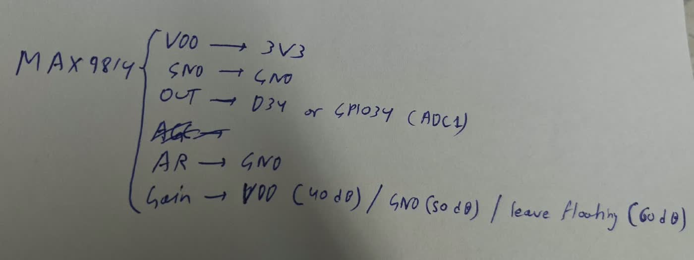 

1. First look: the signal is 98% hum

I streamed the raw ADC to MATLAB and looked at the spectrum. It was just a wall of spikes at 50 Hz and its multiples (my mains runs at 50 Hz, India).

 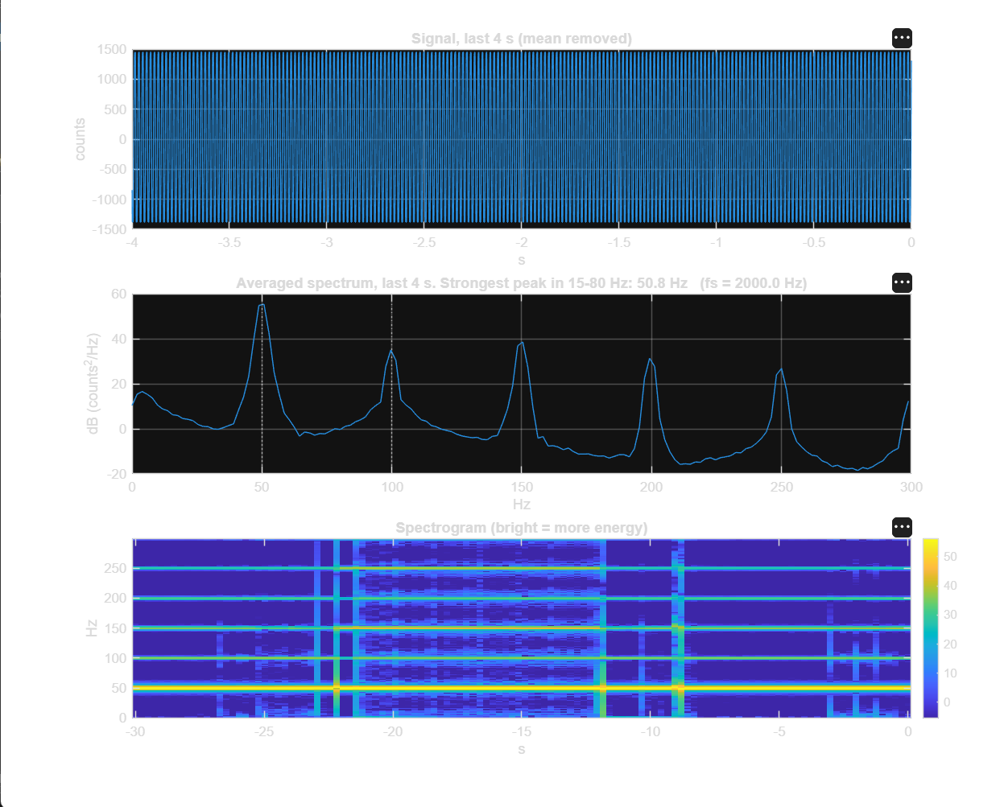 

I fitted a model of the hum, a few harmonics of the mains frequency:

$$x[n] = \sum_{k=1}^{5} \big(a_k\cos(2\pi k f_0 n/f_s) + b_k\sin(2\pi k f_0 n/f_s)\big) + s[n]$$

where $s[n]$ is everything else (the heart sounds and noise). Fitting it gave a few things:

The best $f_0$ was 49.90 Hz, not 50. That matters, because a sharp notch at exactly 50 Hz misses it.
The hum had about 1081 counts rms against 1089 counts rms for the whole raw signal. So its power share was
$$\frac{1081^2}{1089^2} \approx 0.985$$

so about 98.5% of the power was hum.

What's left is $\sqrt{1089^2 - 1081^2} \approx 132$ counts rms. That fits the roughly ±500 counts left over in the second MATLAB plot, where the heart sound is still buried.

 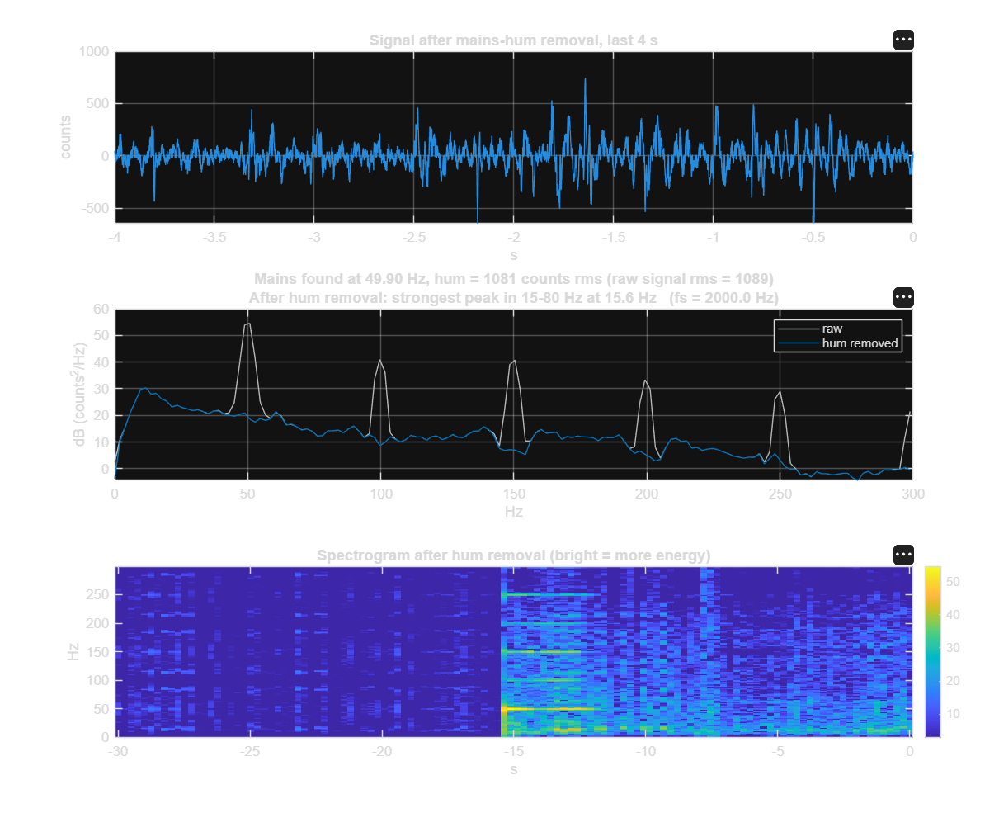 

2. Killing the hum, and why one notch isn't enough

First fix: band-pass plus notches. The chain on the ESP32 is:

A 15–80 Hz band-pass (4th-order Butterworth). Heart sounds live low, so I threw away everything above 80 Hz. That also dodges the 100 and 150 Hz hum harmonics.
Notches at 50 Hz (×2), 100 Hz (×2) and 150 Hz. The two at 50 Hz give a deeper cut. A notch's width is $f_0/Q$, so a Q of 6 at 50 Hz is about 8 Hz wide, which is deliberate, because the mains wanders a bit (49.9 Hz and moving).

Each filter is a biquad (second-order section) running sample by sample:

$$y[n] = b_0 x[n] + b_1 x[n-1] + b_2 x[n-2] - a_1 y[n-1] - a_2 y[n-2]$$

I also tried the fancier approach in simulation, tracking the exact mains frequency with a least-squares fit and subtracting it. This is simulation only. Fixed notches left 200–335 counts of hum, while the tracked fit left 1–36. It looks much better, but wide fixed notches were simpler and good enough on the ESP32, so that's what the final code uses.

 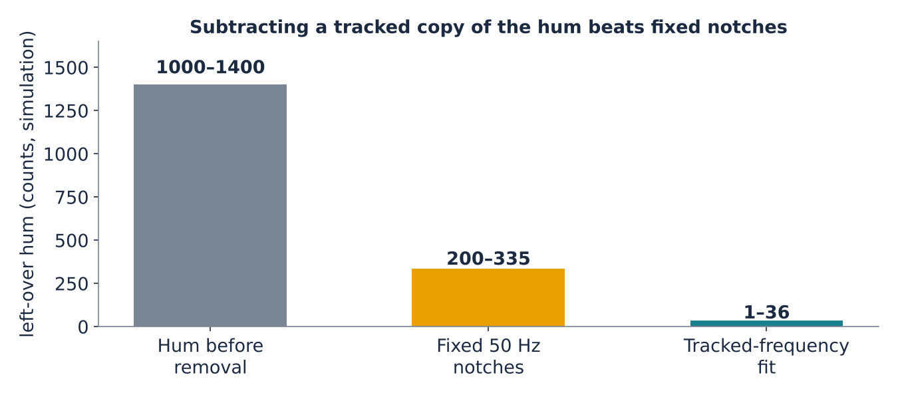 

Sampling: 2000 Hz, averaging 4 ADC reads per sample to reduce noise. The Nyquist limit is 1000 Hz, far above the 80 Hz we care about, so aliasing isn't a worry.

3. MATLAB vs the Arduino Serial Plotter

MATLAB's graphics were broken on my Windows PC (it just wouldn't draw plots properly), so I had to stop using it for live plots. I used the Arduino Serial Plotter instead, and Python for offline analysis.

The plotter's early output was disappointing: the trace sat way below my threshold line and never crossed it.

 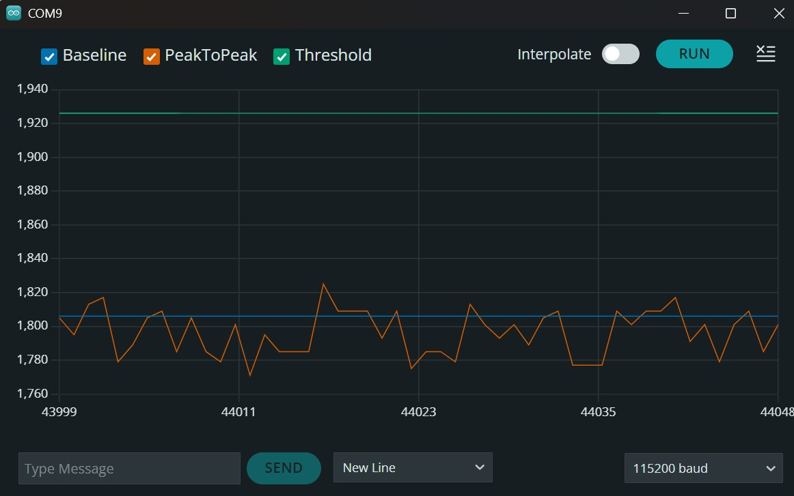 

The reason was the mic itself. The MAX9814 has automatic gain control (AGC), so its output level keeps changing. Any fixed threshold I picked was wrong a minute later.

4. The envelope (so lub and dub become hills)

After filtering you still have a fast wiggle, positive and negative. You don't want to count wiggles, you want to count bursts. So I take the envelope:

$$e[n] = e[n-1] + \alpha\big(|y[n]| - e[n-1]\big), \qquad \alpha = 1 - e^{-2\pi f_c/f_s},\ f_c = 6\ \text{Hz}$$

That's the absolute value followed by a 6 Hz low-pass. The wiggle disappears and each burst becomes one smooth hill. A heartbeat is then two hills: lub (S1) and dub (S2), about 0.24 s apart. I then reduce this to 50 samples a second, since it's smooth anyway.

5. Adaptive thresholds (fixing the AGC problem)

Two trackers follow the envelope $e$. One goes up fast and comes down slowly (it tracks the peaks), and the other does the reverse (it tracks the floor):

$$\text{hi}[n] = \text{hi}[n-1] + a\,(e[n] - \text{hi}[n-1]),\qquad a = \begin{cases}a_\text{up} & e > \text{hi}\\ a_\text{down} & \text{otherwise}\end{cases}$$

and the same for $\text{lo}$, mirrored. The attack time is 0.05 s and the decay time is 2 s. Then the two thresholds are just fractions of the range:

$$T_\text{high} = \text{lo} + 0.50\,(\text{hi}-\text{lo}),\qquad T_\text{low} = \text{lo} + 0.30\,(\text{hi}-\text{lo})$$

Example: floor 1, peaks 5 gives thresholds 3 and 2.2. Press harder so the peaks reach 10, and the thresholds move to 5.5 and 3.7 by themselves. It follows the mic's AGC instead of fighting it.

6. Counting beats: three attempts

Attempt 1: count threshold crossings. On my neck recording this gave 25 crossings for 13 real beats, which is about 143 bpm for a heart that was actually doing about 75. Lub and dub both crossed the line, and a noisy hill crossed it more than once.

 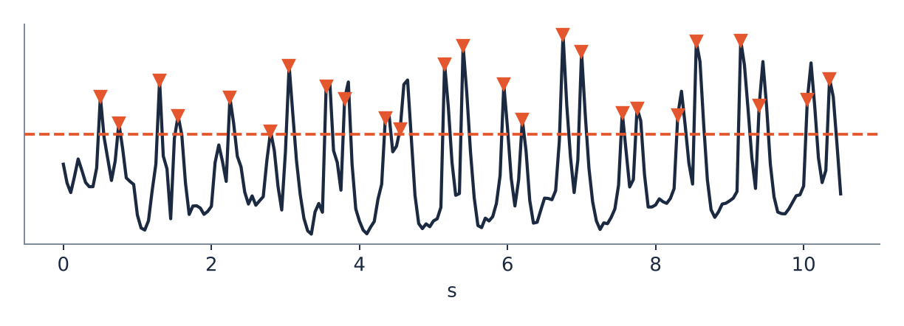 

Attempt 2: Schmitt trigger. Use two thresholds instead of one. A beat is counted when the envelope goes above $T_\text{high}$ while the trigger is "armed". It only re-arms after the envelope falls below $T_\text{low}$. Wobbles between the two levels can't fire it twice. I also added a minimum gap of 0.4 s (a real beat can't repeat that fast) and later a phase gate: once the beat period $T$ is known, a new burst only counts if it starts at the right point in the cycle,

$$u = \frac{(t - t_\text{ref}) \bmod T}{T},\qquad \text{accept if } u < 0.35 \text{ or } u > 0.80$$

so a dub sitting in the middle of the cycle gets rejected. The red LED flashes when this logic accepts a beat. Without the gate, the rate sometimes jumped to double.

 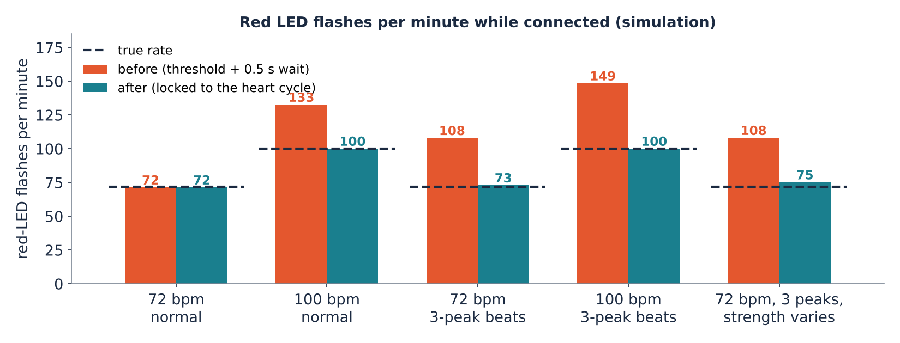 

Attempt 3: correlation (what we use at the end). Counting peaks is fragile when beats are weak. On the neck data, 9 of 27 bursts were under half the height of the strongest one. So instead of counting peaks, I measure how often the whole pattern repeats.

7. Autocorrelation: how long until the signal repeats?

Take the last 4–10 s of the envelope (log-scaled, so one big jolt can't swamp the heartbeat) and compare it to a copy of itself shifted by $\tau$:

$$r(\tau) = \frac{\sum_n \big(e[n]-\bar e\big)\big(e[n+\tau]-\bar e\big)}{\sum_n \big(e[n]-\bar e\big)^2}$$

$r = 1$ would mean a perfect match. I search lags from 0.4 s to 1.5 s (that's 40 to 150 bpm). The highest clear peak gives the beat period $T$, and

$$\text{bpm} = \frac{60}{T}$$

On the neck recording the peak was at 0.797 s, so $60/0.797 = $ 75.3 bpm, with a peak height (quality) of $q = 0.70$.

Checks to avoid being fooled:

The peak has to stand out clearly (prominence at least 0.15).
If a peak at half or a third of the lag is nearly as strong, it takes the shorter lag, so it doesn't lock on to a double period.
The same period has to hold for 2 s in a row before the device says "connected", and three bad seconds in a row make it say it lost the connection.
The final lag is refined with a parabola through the three samples around the peak, so we aren't stuck with a 20 ms grid.

 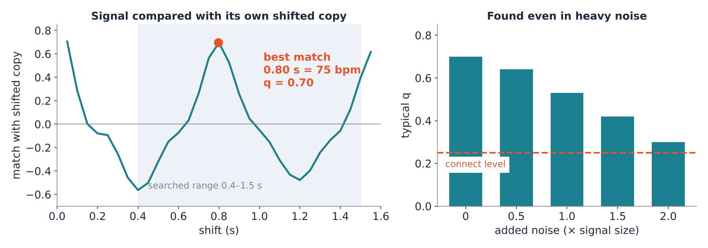 

8. Matched filter: where exactly is each beat?

Autocorrelation gives the tempo, not the exact beat times. For those:

Fold the envelope at period $T$, so every beat lands on top of the others, and average them. That's a clean template of one typical lub-dub.
Slide the template along the signal and compute the normalised correlation at each position:
$$c[j] = \frac{\sum_i \big(e[j+i]-\bar e_j\big)\big(m[i]-\bar m\big)}{\sqrt{\sum_i \big(e[j+i]-\bar e_j\big)^2 \sum_i \big(m[i]-\bar m\big)^2}}$$
Peaks above half of the strongest peak, and at least $0.6\,T$ apart, are the beats.

From those beat times come the NOW rate (last 4 s, falling back to AVG if the two disagree by more than 25%) and the rhythm label. The label uses the coefficient of variation of the gaps between beats:

$$\text{CV} = \frac{\sigma_\text{gap}}{\mu_\text{gap}}$$

Under 8% is Steady, under 15% Slight, otherwise Uneven.

 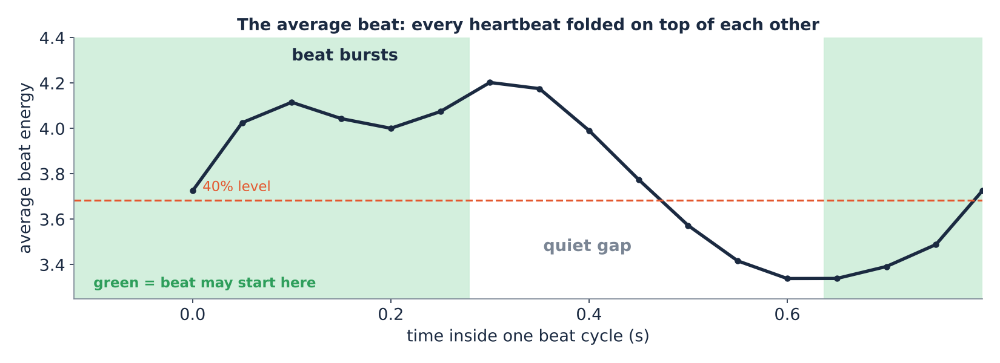 

9. The neck results

From the neck recording (a video I digitised, so low resolution but real):

Measurement	Value
Beats	13, spaced 0.74 to 0.91 s apart
Autocorrelation	0.797 s, 75.3 bpm, $q = 0.70$
Matched filter	75.2 bpm (agrees)
Rhythm CV	5.4%, so Steady
Lub to dub gap	242 ± 40 ms (12 pairs)
Dub vs lub amplitude	about 1.05 (the dub is as strong as the lub)
One-threshold counting	25 crossings for 13 beats, about 143 bpm. Wrong.

 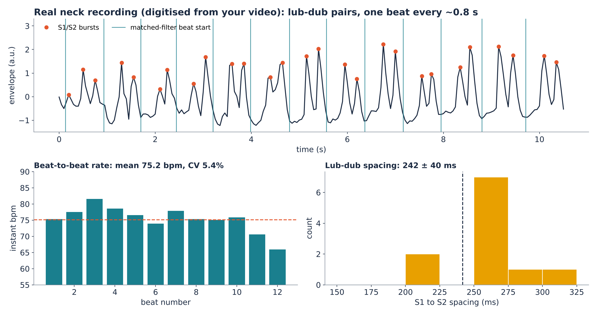 

I also tested a simulated heart ramping from 72 to 110 bpm (simulation only). NOW follows it quickly and AVG lags behind, which is exactly what a 4 s window versus a 10 s window should do.

10. Other things that broke
What broke	What I did
The display froze for a moment every second. The analysis was blocking the sampling.	Sampling stays on one ESP32 core, analysis and display run on the other.
Two mics to cancel room noise. One of them died (the one on GPIO34).	Went on with a single mic on GPIO35. Will revisit.
The I2C LCD backpack didn't arrive.	Taught the sketch to drive a bare 16-pin LCD directly.
I wasn't sure the LCD would work first time.	Added Bluetooth, so the same text and a live plot show in a browser. For some reason the Bluetooth isnt setting up. I am positive I will sort it out and am discussing with LLM regarding the same.

Still left:
I havent tested or compared the performance with an industry digital steth, we are positive about the performance since I checked it on few people and asked them to match their beaat with the Red LED and it worked, other than few instances of double counting/miscounting. I will sort it somehow
I will try and implement ML, add a speaker, use wifi once winter vacations start. I am yet to write a formal report as well.

This project was reviewed positively by Dr. Suryasnata Tripathy of the Biomedical Engineering department at IIT Ropar.
